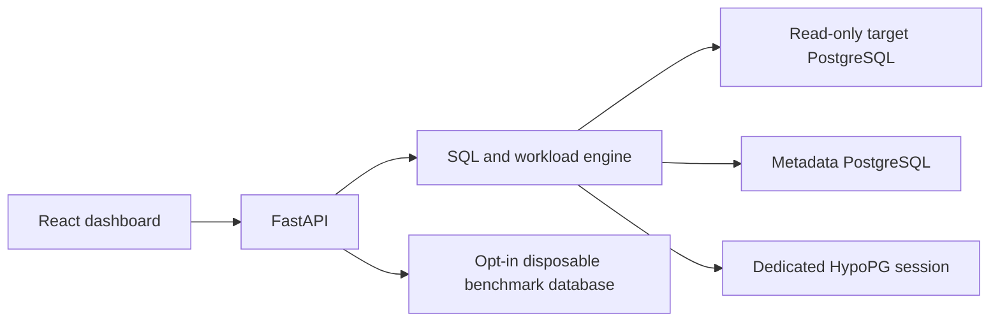

# IndexPilot

An explainable, workload-aware index recommendation and performance validation system for PostgreSQL.

IndexPilot is being built to answer: **which combination of indexes helps this workload within a storage budget, and does the benefit survive actual measurement?** Extra indexes consume storage and add work to writes, so recommending one index for every predicate is insufficient.

## Current status

Milestones 0–1: published technical design and a verified PostgreSQL development environment. Deterministic e-commerce data, separate metadata/demo/benchmark databases, least-privilege roles, pg_stat_statements and HypoPG are working. The recommendation engine, API and dashboard are not implemented yet. There are no performance benchmark results. See [progress](docs/PROGRESS.md).

## Architecture and planned stack

A Python modular monolith will separate the database engine from FastAPI routes. PostgreSQL will hold application metadata separately from the target database. React, TypeScript, Tailwind CSS and Recharts will present actual API results after the engine works.

The engine will use psycopg 3, pglast, PostgreSQL catalogs, JSON EXPLAIN and HypoPG. Metadata will use SQLAlchemy and Alembic. Tests will use pytest and real PostgreSQL integration tests; Docker Compose and GitHub Actions will provide reproducible execution.



## Requirements and setup

The tested environment uses Python 3.12.13, PostgreSQL 18.6, HypoPG 1.4.3, pg_stat_statements 1.12, Docker Engine 29.1.3 and Compose 2.40.3. Python dependencies are locked in `uv.lock`; the PostgreSQL image is pinned by digest and HypoPG by revision/checksum. Node.js is only needed when frontend development begins.

With Docker/Compose and [uv](https://docs.astral.sh/uv/) installed, run from the checkout:

```powershell
git clone https://github.com/honey-cake7/IndexPilot.git
cd IndexPilot
uv sync --locked
uv run python scripts/init_local.py
docker compose up -d --build --wait
uv run python scripts/generate_demo.py
uv run python scripts/generate_demo.py --target bench
uv run python scripts/verify_environment.py
uv run pytest --integration -q
```

For this Windows machine, Docker runs inside WSL: replace `docker compose` above with `wsl --exec docker compose`, from the same project directory, and keep a WSL terminal open. Detailed setup, data reset, configuration and troubleshooting are in [DEVELOPMENT.md](docs/DEVELOPMENT.md). There is no API/frontend entrypoint yet. Passwords are generated into ignored local files and never committed.

## Planned example workflow

Start the isolated demo; validate its capabilities; submit SELECT queries with frequencies; inspect real plans; generate and evaluate candidate index sets; optimize within a byte budget; review explanations; explicitly launch isolated before/after benchmarking; save and export the findings.

Ordinary analysis will use EXPLAIN without ANALYZE. Hypothetical planner cost is **not milliseconds**. Index creation will require deliberate approval and an explicitly disposable benchmark target. There will be no general production index deployment endpoint.

## Documentation

- [Dependency-ordered roadmap and acceptance criteria](docs/ROADMAP.md)
- [Executed development setup and test commands](docs/DEVELOPMENT.md)
- [Verified progress and commit records](docs/PROGRESS.md)
- [Architecture and security boundaries](docs/ARCHITECTURE.md)
- [Metadata design and ER diagram](docs/DATABASE_DESIGN.md)
- [Optimization algorithm](docs/OPTIMIZATION_ALGORITHM.md)
- [Benchmark methodology and evidence policy](docs/BENCHMARKING.md)
- [Technical decisions](docs/DECISIONS.md)
- [Learning notes](docs/LEARNING_NOTES.md)

## Limitations

The current implementation provisions and verifies the local databases; it does not recommend indexes yet. Planned SQL support will intentionally be narrower than PostgreSQL: simple SELECTs over inspected ordinary tables with supported built-in types and operators. Unsupported SQL will receive an explanation rather than a speculative recommendation. Small or low-selectivity tables may correctly retain sequential scans. Greedy selection has no general guarantee of the globally optimal index set.

The project relies on PostgreSQL, HypoPG and pglast rather than an LLM to determine index validity. Technical sources are linked in the relevant design documents. AI-assisted contributions must meet the same review, test and evidence standards as other contributions.
