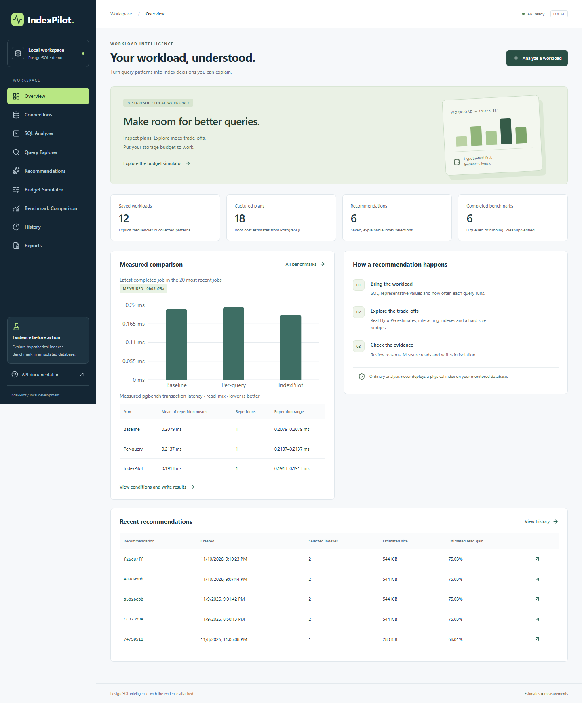
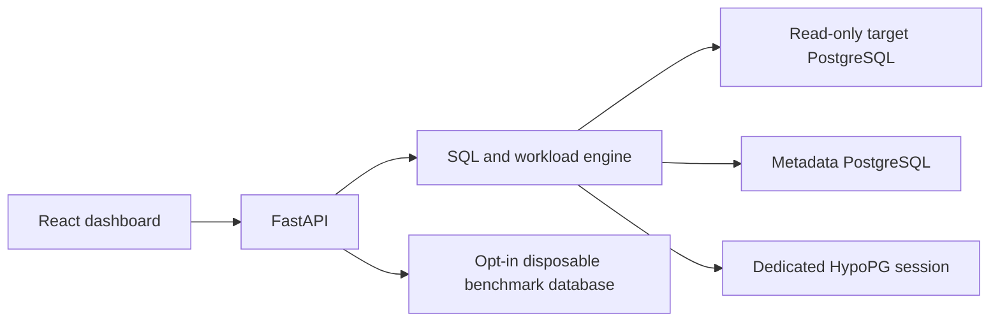

# IndexPilot

An explainable, workload-aware index recommendation and performance validation system for PostgreSQL.

IndexPilot is being built to answer: **which combination of indexes helps this workload within a storage budget, and does the benefit survive actual measurement?** Extra indexes consume storage and add work to writes, so recommending one index for every predicate is insufficient.

## Current status

Milestones 0–11: verified PostgreSQL environment, saved workloads/plans/candidates, HypoPG evaluation, storage-budget selection, explainable recommendations, isolated physical benchmarking and a nine-view React dashboard. Durable versioned reports now freeze saved decisions and selected measurements, export JSON/Markdown, and support filtered history/comparison. [Dashboard setup](docs/FRONTEND.md), [report guide](docs/REPORTS.md) and [actual report export](sample/reports/README.md). A [local measured example](sample/benchmarks/README.md) includes improvements and regressions. Final end-to-end validation and complete integration CI remain M12 work. See [progress](docs/PROGRESS.md).



## Architecture and planned stack

A Python modular monolith separates the database engine from FastAPI routes. PostgreSQL holds application metadata separately from the target database. React, TypeScript, Vite, Tailwind CSS and Recharts present actual API results through a generated typed client.

The engine will use psycopg 3, pglast, PostgreSQL catalogs, JSON EXPLAIN and HypoPG. Metadata will use SQLAlchemy and Alembic. Tests will use pytest and real PostgreSQL integration tests; Docker Compose and GitHub Actions will provide reproducible execution.



## Requirements and setup

The tested environment uses Python 3.12.13, PostgreSQL 18.6, HypoPG 1.4.3, pg_stat_statements 1.12, Docker Engine 29.1.3, Compose 2.40.3 and Node 26.13.0/npm 11.20.0. Python and frontend dependencies are locked in `uv.lock` and `frontend/package-lock.json`; the PostgreSQL image is pinned by digest and HypoPG by revision/checksum.

With Docker/Compose and [uv](https://docs.astral.sh/uv/) installed, run from the checkout:

```powershell
git clone https://github.com/honey-cake7/IndexPilot.git
cd IndexPilot
uv sync --locked
uv run python scripts/init_local.py
docker compose up -d --build --wait
uv run python scripts/generate_demo.py
uv run python scripts/generate_demo.py --target bench
uv run python scripts/verify_environment.py
uv run alembic upgrade head
uv run pytest --integration -q
uv run uvicorn indexpilot.main:app --host 127.0.0.1 --port 8000
```

For this Windows machine, Docker runs inside WSL: replace `docker compose` above with `wsl --exec docker compose`, from the same project directory, and keep a WSL terminal open. Open API docs at `http://127.0.0.1:8000/docs`; check `/health/ready` and `/api/v1/connections/demo`. Detailed setup, data reset, configuration and troubleshooting are in [DEVELOPMENT.md](docs/DEVELOPMENT.md). Passwords are generated into ignored local files and never committed.

Start the dashboard in a **second terminal**, from the repository root:

```powershell
. .\scripts\use_node.ps1
cd frontend
npm ci
npm run dev
```

Open **http://127.0.0.1:5173**. The optional Windows x64 helper installs checksum-verified Node under ignored `.tools/` and sets PATH only for that terminal. Other platforms can install the pinned `.node-version` normally. Both backend and Vite must remain running; port 8000 is the API, not the dashboard. [Full frontend guide](docs/FRONTEND.md).

## Planned example workflow

Start the isolated demo; validate its capabilities; submit SELECT queries with frequencies; inspect real plans; generate and evaluate candidate index sets; optimize within a byte budget; review explanations; explicitly launch isolated before/after benchmarking; save and export the findings.

Ordinary analysis will use EXPLAIN without ANALYZE. Hypothetical planner cost is **not milliseconds**. Index creation will require deliberate approval and an explicitly disposable benchmark target. There will be no general production index deployment endpoint.

## Documentation

- [Dependency-ordered roadmap and acceptance criteria](docs/ROADMAP.md)
- [Executed development setup and test commands](docs/DEVELOPMENT.md)
- [Local dashboard, typed API client and real browser verification](docs/FRONTEND.md)
- [Versioned reports, privacy policy, exports and filtered history](docs/REPORTS.md)
- [Workload input, parameters, snapshots and interval semantics](docs/WORKLOADS.md)
- [Schema inspection, SQL resolution and estimated plans](docs/PLAN_ANALYSIS.md)
- [B-Tree candidate generation, bounds and duplicate detection](docs/CANDIDATES.md)
- [HypoPG set evaluation, estimated costs and cleanup](docs/HYPOTHETICAL_EVALUATION.md)
- [Verified progress and commit records](docs/PROGRESS.md)
- [Architecture and security boundaries](docs/ARCHITECTURE.md)
- [Metadata design and ER diagram](docs/DATABASE_DESIGN.md)
- [Working optimization API, algorithm and limits](docs/OPTIMIZATION_ALGORITHM.md)
- [Saved recommendations, explanations and SQL export](docs/RECOMMENDATIONS.md)
- [Benchmark methodology and evidence policy](docs/BENCHMARKING.md)
- [Technical decisions](docs/DECISIONS.md)
- [Learning notes](docs/LEARNING_NOTES.md)

## Limitations

The API supports the configured local demo and a narrow SQL/catalog subset. Ordinary planning uses EXPLAIN without ANALYZE; physical execution requires a separate, explicitly confirmed benchmark job in the disposable database. That runner supports only the five sample tables, bounded sizes and the pinned local Compose environment. It creates fresh job schemas and preserves public sample tables/indexes. Greedy selection offers no global-optimum guarantee. Write penalties are heuristics; actual controlled write measurements are separate evidence. Local timings vary, and no universal improvement is claimed. Reports freeze historical evidence and disclose missing measurements and their SQL inclusion policy. Planner costs are not milliseconds.

The project relies on PostgreSQL, HypoPG and pglast rather than an LLM to determine index validity. Technical sources are linked in the relevant design documents. AI-assisted contributions must meet the same review, test and evidence standards as other contributions.
