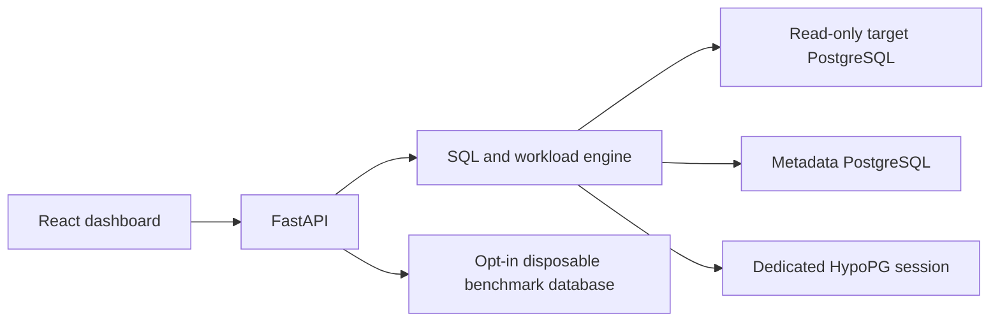

# IndexPilot

An explainable, workload-aware index recommendation and performance validation system for PostgreSQL.

IndexPilot is being built to answer: **which combination of indexes helps this workload within a storage budget, and does the benefit survive actual measurement?** Extra indexes consume storage and add work to writes, so recommending one index for every predicate is insufficient.

## Current status

Milestone 0: repository inspection and technical design. No application, database provisioning, optimizer, API or dashboard is implemented yet. There are no benchmark results. See [progress](docs/PROGRESS.md) for verified work and environment constraints.

## Architecture and planned stack

A Python modular monolith will separate the database engine from FastAPI routes. PostgreSQL will hold application metadata separately from the target database. React, TypeScript, Tailwind CSS and Recharts will present actual API results after the engine works.

The engine will use psycopg 3, pglast, PostgreSQL catalogs, JSON EXPLAIN and HypoPG. Metadata will use SQLAlchemy and Alembic. Tests will use pytest and real PostgreSQL integration tests; Docker Compose and GitHub Actions will provide reproducible execution.



## Requirements and setup

The planned reference environment is Python 3.12, PostgreSQL 18 with pg_stat_statements and HypoPG, Docker Engine with Compose v2, and a supported Node.js LTS release. Exact application dependencies and container versions will be locked when introduced and tested.

For the documentation currently available:

```powershell
git clone https://github.com/honey-cake7/IndexPilot.git
cd IndexPilot
git status
```

Docker startup, configuration, backend/frontend execution and test commands will be added with their working implementations. Do not assume `docker compose up` or an application entrypoint exists yet. Database passwords will be supplied by environment or local secret files, never committed.

## Planned example workflow

Start the isolated demo; validate its capabilities; submit SELECT queries with frequencies; inspect real plans; generate and evaluate candidate index sets; optimize within a byte budget; review explanations; explicitly launch isolated before/after benchmarking; save and export the findings.

Ordinary analysis will use EXPLAIN without ANALYZE. Hypothetical planner cost is **not milliseconds**. Index creation will require deliberate approval and an explicitly disposable benchmark target. There will be no general production index deployment endpoint.

## Documentation

- [Dependency-ordered roadmap and acceptance criteria](docs/ROADMAP.md)
- [Verified progress and commit records](docs/PROGRESS.md)
- [Architecture and security boundaries](docs/ARCHITECTURE.md)
- [Metadata design and ER diagram](docs/DATABASE_DESIGN.md)
- [Optimization algorithm](docs/OPTIMIZATION_ALGORITHM.md)
- [Benchmark methodology and evidence policy](docs/BENCHMARKING.md)
- [Technical decisions](docs/DECISIONS.md)
- [Learning notes](docs/LEARNING_NOTES.md)

## Limitations

Everything beyond the documented inspection/design is planned. Initial SQL support will intentionally be narrower than PostgreSQL: simple SELECTs over inspected ordinary tables with supported built-in types and operators. Unsupported SQL will receive an explanation rather than a speculative recommendation. Small or low-selectivity tables may correctly retain sequential scans. Greedy selection has no general guarantee of the globally optimal index set.

The project relies on PostgreSQL, HypoPG and pglast rather than an LLM to determine index validity. Technical sources are linked in the relevant design documents. AI-assisted contributions must meet the same review, test and evidence standards as other contributions.
