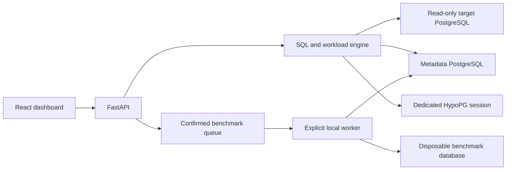

# IndexPilot

[](https://github.com/honey-cake7/IndexPilot/actions/workflows/ci.yml)

An explainable, workload-aware index recommendation and performance validation system for PostgreSQL.

IndexPilot answers: **which combination of indexes helps this workload within a storage budget, and does the benefit survive actual measurement?** Extra indexes consume storage and add work to writes, so recommending one index for every predicate is insufficient.

## Current status

The complete local workflow is implemented: saved workloads/plans/candidates, HypoPG evaluation, storage-budget selection, explainable recommendations, isolated physical benchmarking, nine dashboard views, filtered history and versioned JSON/Markdown reports. [Clean-checkout validation](docs/VALIDATION.md), [engineering findings and all 18 completion requirements](docs/EVALUATION.md), [actual measured evidence](sample/benchmarks/README.md) and [report export](sample/reports/README.md) document what works and its limits. Exact checks, commits and CI outcomes are recorded in [progress](docs/PROGRESS.md).

Executed on a clean Windows/WSL checkout and fresh Linux CI: **425 backend tests, 29 component tests and six real browser scenarios passed**, including actual report retrieval across API process restarts. The first Linux provisioning failure was reproduced and corrected without relaxing host secret permissions. [Validation evidence](sample/validation/README.md).


## Architecture and stack

A Python modular monolith separates the database engine from FastAPI routes. PostgreSQL holds application metadata separately from the target database. React, TypeScript, Vite, Tailwind CSS and Recharts present actual API results through a generated typed client.

The engine uses psycopg 3, pglast, PostgreSQL catalogs, JSON EXPLAIN and HypoPG. SQLAlchemy/Alembic persist metadata. Pytest, actual PostgreSQL/HypoPG integration tests and Playwright exercise the application; pinned Docker Compose provisioning and GitHub Actions reproduce the checks.



## Requirements and setup

The tested environment uses Python 3.12.13, PostgreSQL 18.6, HypoPG 1.4.3, pg_stat_statements 1.12, Docker Engine 29.1.3, Compose 2.40.3 and Node 26.13.0/npm 11.20.0. Python and frontend dependencies are locked in `uv.lock` and `frontend/package-lock.json`; the PostgreSQL image is pinned by digest and HypoPG by revision/checksum.

With Docker/Compose and [uv](https://docs.astral.sh/uv/) installed, run from the checkout:

```powershell
git clone https://github.com/honey-cake7/IndexPilot.git
cd IndexPilot
uv sync --locked
uv run python scripts/init_local.py
docker compose up -d --build --wait
uv run python scripts/generate_demo.py
uv run python scripts/generate_demo.py --target bench
uv run python scripts/verify_environment.py
uv run alembic upgrade head
uv run pytest --integration -q
uv run uvicorn indexpilot.main:app --host 127.0.0.1 --port 8000
```

For this Windows machine, Docker runs inside WSL: replace `docker compose` above with `wsl --exec docker compose`, from the same project directory, and keep a WSL terminal open. Open API docs at `http://127.0.0.1:8000/docs`; check `/health/ready` and `/api/v1/connections/demo`. Detailed setup, data reset, configuration and troubleshooting are in [DEVELOPMENT.md](docs/DEVELOPMENT.md). Passwords are generated into ignored local files and never committed.

Start the dashboard in a **second terminal**, from the repository root:

```powershell
. .\scripts\use_node.ps1
cd frontend
npm ci
npm run dev
```

Open **http://127.0.0.1:5173**. The optional Windows x64 helper installs checksum-verified Node under ignored `.tools/` and sets PATH only for that terminal. Other platforms can install the pinned `.node-version` normally. Both backend and Vite must remain running; port 8000 is the API, not the dashboard. [Full frontend guide](docs/FRONTEND.md).

## Demonstrate the workflow

In Connections, validate the demo. In SQL Analyzer, submit the editable SELECT or a `.sql` file with explicit frequencies/representative values. Inspect captured plans in Query Explorer, then use Budget Simulator to run real HypoPG optimization. Save the recommendation and review its index/query explanations. Changing a budget saves a new run rather than rewriting history.

For actual measurements, select that recommendation in Benchmark Comparison, review the bounded dataset settings and check the explicit disposable-database confirmation. Queue the job, then run this foreground worker in a third root terminal:

```powershell
uv run python scripts/run_benchmarks.py --serve
```

Inspect all three arms, phase conditions, storage and read/write regressions. In Reports, save a report with the desired SQL inclusion policy and completed benchmark evidence; download JSON/Markdown and reopen it through History. [Full report instructions](docs/REPORTS.md) and [benchmark reproduction](sample/benchmarks/README.md).

Ordinary analysis uses EXPLAIN without ANALYZE. Planner cost is **not milliseconds**. Physical writes require explicit confirmation in the disposable benchmark database. There is no production index deployment endpoint.

## Verify the project

After setup, with uv/Node/npm available in the terminal:

```powershell
# Lint, unit and frontend checks; no database required
uv run python scripts/check.py --output artifacts/checks-unit.json

# Actual PostgreSQL/API tests followed by six real browser scenarios
uv run python scripts/check.py --integration --browser --output artifacts/checks.json
```

Leave the validation benchmark queue idle and stop other workers first. The suites run sequentially and include a report read across actual API process restarts. Validation servers own 8010/5174 and ephemeral restart ports; development servers are preserved. [Fresh-checkout and isolated-project instructions](docs/VALIDATION.md) explain provisioning, migrations, evidence artifacts and CI.

## Documentation

- [Dependency-ordered roadmap and acceptance criteria](docs/ROADMAP.md)
- [Executed development setup and test commands](docs/DEVELOPMENT.md)
- [Fresh-checkout checks and full PostgreSQL/browser CI](docs/VALIDATION.md)
- [Engineering evaluation and completion evidence](docs/EVALUATION.md)
- [Local dashboard, typed API client and real browser verification](docs/FRONTEND.md)
- [Versioned reports, privacy policy, exports and filtered history](docs/REPORTS.md)
- [Workload input, parameters, snapshots and interval semantics](docs/WORKLOADS.md)
- [Schema inspection, SQL resolution and estimated plans](docs/PLAN_ANALYSIS.md)
- [B-Tree candidate generation, bounds and duplicate detection](docs/CANDIDATES.md)
- [HypoPG set evaluation, estimated costs and cleanup](docs/HYPOTHETICAL_EVALUATION.md)
- [Verified progress and commit records](docs/PROGRESS.md)
- [Architecture and security boundaries](docs/ARCHITECTURE.md)
- [Metadata design and ER diagram](docs/DATABASE_DESIGN.md)
- [Working optimization API, algorithm and limits](docs/OPTIMIZATION_ALGORITHM.md)
- [Saved recommendations, explanations and SQL export](docs/RECOMMENDATIONS.md)
- [Benchmark methodology and evidence policy](docs/BENCHMARKING.md)
- [Technical decisions](docs/DECISIONS.md)
- [Learning notes](docs/LEARNING_NOTES.md)

## Limitations

The API supports the configured local demo and a narrow SQL/catalog subset. Ordinary planning uses EXPLAIN without ANALYZE; physical execution requires a separate, explicitly confirmed benchmark job in the disposable database. That runner supports only the five sample tables, bounded sizes and the pinned local Compose environment. It creates fresh job schemas and preserves public sample tables/indexes. Greedy selection offers no global-optimum guarantee. Write penalties are heuristics; actual controlled write measurements are separate evidence. Local timings vary, and no universal improvement is claimed. Reports freeze historical evidence and disclose missing measurements and their SQL inclusion policy. Planner costs are not milliseconds.

The project relies on PostgreSQL, HypoPG and pglast rather than an LLM to determine index validity. Technical sources are linked in the relevant design documents. AI-assisted contributions must meet the same review, test and evidence standards as other contributions.
