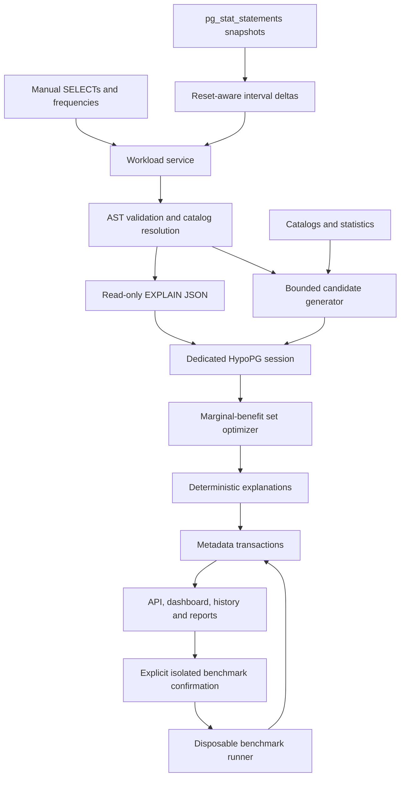

# Architecture

Status: M1–M5 provisioning, backend, workloads, plans and candidates are implemented. M6–M7 add HypoPG evaluation and workload-aware selection; M8 adds frozen recommendation explanations and separate SQL artifacts. Benchmarks and the dashboard remain planned. Ingestion alone never authorizes planning; plan/evaluation/optimization paths apply a separate catalog safety policy.

## Boundaries and flow

IndexPilot starts as one Python application with focused packages. FastAPI validates HTTP requests and delegates to services. SQL parsing, candidate generation, plan parsing and optimization are independent Python modules; they can be tested without a server.

Three databases have different jobs. `indexpilot_meta` stores application records and migrations. `indexpilot_demo` contains the sample workload; the analyzer role can inspect and plan but not modify its tables. `indexpilot_bench` is disposable and has a separate writer/owner role. A marker alone is insufficient isolation: verify configured server identity, database identity and role; reject identities shared with metadata or monitored targets even through another hostname.

Connection records store a configured credential reference, not a password or password-bearing DSN. Local environment/local secrets supply values. Only administrator-configured targets are allowed initially, preventing the HTTP connection feature from becoming an arbitrary network connection proxy. Public deployment, multi-tenancy and user authentication are outside the initial local-only demo; bind locally and document that limitation.

## Target safety

Ordinary analysis uses EXPLAIN without ANALYZE, least-privilege roles, fixed trusted search_path, read-only transactions and bounded connection/lock/statement timeouts. There is no physical target DDL endpoint. HypoPG functions are called by internal code with quoted, generated DDL, on a dedicated held session; cleanup runs on both success and failure. Failed cleanup means close/discard the connection.

SELECT syntax alone does not guarantee safety. Planner constant folding can invoke immutable functions; operators, casts, views, policies and extension types can invoke code indirectly. The first implementation must therefore validate an intentionally narrow AST subset, permit inspected ordinary tables and supported built-in types/operators, reject unapproved function calls/casts, modifying CTEs, SELECT INTO, locks and unresolved names, and refuse untrusted views/RLS policies. Read-only settings cannot prevent arbitrary external side effects of malicious database code. Support is limited to trusted, administrator-controlled databases, not hostile database servers.

Uploaded SQL is input, never a script to execute. Reject unsupported statements individually and report line/statement context. Parameter placeholders require explicit representative values and types; do not interpolate them with string replacement. Query text and literal values may contain business data, so avoid logging them, bound uploads and document local metadata retention.

M4 implements this boundary with permanent heap-table/type checks, dependency guards, read privileges, ACCESS SHARE locks, schema-qualified relations and pg_catalog-qualified operators/casts/aggregates. It refuses RLS/views/inheritance/generated columns and unsupported index/type dependencies. Schema inspection is broader than planning admission. Catalog context and raw plans are frozen in metadata; no actual execution metrics are generated. See [PLAN_ANALYSIS.md](PLAN_ANALYSIS.md) for the precise supported subset and the trusted-server limitation.

## Engine contracts

- Workload: query identity, representative SQL/bindings, positive frequency, interval provenance and warnings. Split frequency among representative parameter scenarios; do not count each scenario as the full query frequency.
- Schema: server/database/relation identity, columns/types/statistics, valid existing index definitions and observation time.
- Plan: recursive node tree and raw JSON; estimated root total cost, not sum of all node totals.
- Candidate: canonical schema/table/key signature, quoted DDL, reasons, linked queries and estimated size or explicit unknown.
- Evaluator: `evaluate(frozenset[candidate_id])` returns per-query plans, root costs, per-index bytes and warnings for the entire set in one session.
- Optimizer: pure orchestration over the evaluator contract, settings and workload; returns trial trace, selected/rejected sets, objective and stop reason.
- Benchmark: fixed allowlisted disposable target and saved recommendation IDs; no arbitrary submitted DDL; immutable measurement conditions and individual samples where percentiles are reported.

M6's cache belongs to one evaluator on one exclusively held repeatable-read connection, with copied query/binding/frequency/candidate context. A frozenset candidate key is sufficient inside that scope; checked planner settings must remain unchanged. It stores at most 65 sets including baseline, deep-copies values and is discarded on any failure or connection exit. There is no persistent or cross-run estimate cache. A future shared cache would additionally require target, schema/statistics and complete query/settings provenance. Concurrent statistics/physical changes are not fully frozen by a database transaction.

M5 consumes saved resolved plans, refreshes referenced table/index metadata and rejects stale identities/types. Its pure generator produces bounded B-Tree alternatives and deterministic quoted DDL; an API service persists batches, source membership, decisions and normalized evidence. Candidate priority uses structural heuristics only. No hypothetical or physical indexes are created by the generation endpoint. See [CANDIDATES.md](CANDIDATES.md).

M6 revalidates saved query/catalog bindings and structurally recompiles candidate DDL. It obtains a fresh empty-set baseline, then resets, creates each complete set, EXPLAINs every source query, reads optional HypoPG sizes and verifies cleanup. Rollback alone does not erase HypoPG memory; both hypothetical and hidden-index state are explicitly cleared. Cleanup failure closes the physical connection. Synchronous runs are atomically saved only after completion/failure/unavailability, with no partial successful comparisons on failure. See [HYPOTHETICAL_EVALUATION.md](HYPOTHETICAL_EVALUATION.md).

M7's optimizer/greedy.py depends on an evaluator contract, typed models and pure objective arithmetic, not FastAPI or SQL execution. It evaluates each selected-set-plus-candidate alternative, scores frequency-weighted read cost plus optional heuristic write penalty, enforces actual combined estimated bytes/regression limits and records deterministic choices. Rounds must fit the evaluation allowance completely, with a reserved final uncached EXPLAIN. The API service holds the M6 session for the whole search; its private cache capacity follows the configured evaluation bound. A final cost/storage drift or failed database operation publishes no partial selection. Successful evaluation evidence and foreign-keyed optimization history commit together in one metadata transaction. See [OPTIMIZATION_ALGORITHM.md](OPTIMIZATION_ALGORITHM.md).

## Recommendation snapshots

M8 creates versioned explanations from completed M7 evidence using metadata only. It structurally rebuilds candidate SQL against frozen catalog context, checks source consistency and saves selected membership, query/plan snapshots, provenance and scoped relevance links in one transaction. Query contributions describe the final whole set; index benefits describe their original selection step. Write overhead is qualitative/heuristic, with no fabricated runtime or confidence metric. GET reads the snapshot independently of current source/target state. Repeat creation reuses one snapshot per optimization, with bounded row-lock serialization. Separate JSON/SQL-download routes export quoted commands without executing them. See [RECOMMENDATIONS.md](RECOMMENDATIONS.md).

## API boundaries

Version routes under `/api/v1`. Health is separate. Connections expose sanitized capability data; workloads expose manual ingestion/snapshots; plans/schema/candidates/evaluations expose inspection; optimizations persist complete analyses; recommendations/history/reports retrieve saved evidence. Benchmarks expose explicit creation confirmation and a job status resource, with queued/running/completed/failed states.

Use Pydantic request/response types, consistent `{error: {code, message, request_id}}` errors, bounded payloads and pagination. Database exceptions become safe domain errors; never return raw exceptions containing credentials. Bind to loopback by default, use a restrictive local frontend CORS origin, and do not enable credentialed wildcard CORS.

For long benchmarks, use a bounded local worker rather than a distributed queue. Persist job transitions; mark interrupted running jobs failed on restart; prevent overlapping jobs from changing the same benchmark database. Target SQL analysis and benchmark execution have separate connections and permissions.

## Sources

PostgreSQL describes [machine-readable plans and relative planner costs](https://www.postgresql.org/docs/18/using-explain.html). HypoPG documents [session-private hypothetical indexes and the restriction to non-ANALYZE EXPLAIN](https://hypopg.readthedocs.io/en/rel1_stable/usage.html). These constraints determine the evaluator/session design; they do not establish real runtime gains. See the [roadmap](ROADMAP.md) for verification requirements.
