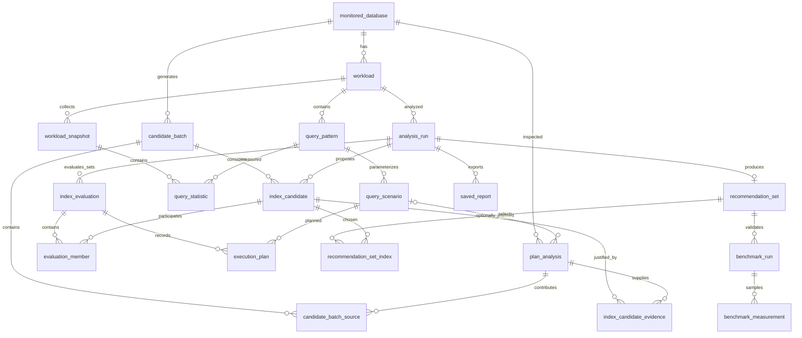

# Metadata database design

Status: migrations 0001–0003 implement targets, workloads, statistics and plan analysis. M5 migrations 0004–0005 add candidate batches, source membership, decisions and normalized evidence. Evaluation/recommendation/benchmark entities remain planned. Demo business data never belongs in metadata.

Every entity has a primary key (UUID where externally addressed; bounded integer IDs are acceptable for local child rows), creation time and appropriate foreign keys. Use timezone-aware timestamps, BIGINT bytes/counters/query IDs, finite nonnegative costs and positive finite frequencies. PostgreSQL query IDs can be signed; do not impose a positive queryid constraint.

| Entity | Main content and constraints |
| --- | --- |
| monitored_database | Unique configured target key; safe host/database/role identity and credential reference; no password or secret DSN. |
| workload | Database FK, source, name; each analysis uses an immutable revision of queries/frequencies. |
| query_pattern | Workload FK, source identity and normalized text; manual fingerprint separate from server queryid. Server identity includes database, role, queryid and top-level flag; queryid alone is insufficient. |
| query_scenario | Pattern FK, representative statement/bindings, frequency share; unresolved parameters explicitly prevent planning. Values are sensitive local data. |
| workload_snapshot | Workload FK, collection time, server start/reset/deallocation metadata, collection outcome and extension version. |
| query_statistic | Snapshot and pattern FKs with composite uniqueness; raw cumulative calls/time/rows/buffers. Derived deltas retain their predecessor and validity reason, or are recalculated from raw snapshots. |
| analysis_run | Workload revision, target schema/statistics provenance, configuration, status and algorithm version; settings frozen on completion. |
| index_candidate | Analysis FK, canonical index signature, ordered key details, reasons, estimated bytes; unique signature within analysis. |
| index_evaluation | Analysis FK, canonical set signature, estimated weighted cost and warnings; unique compatible set signature within run. |
| evaluation_member | Composite PK of evaluation and candidate FKs; estimated bytes for this evaluation when available. |
| execution_plan | Evaluation and scenario FKs; raw JSON and extracted root metrics; unique pair; FK scope ensures same analysis workload. Empty set evaluation supplies baseline plans. |
| recommendation_set | Unique analysis FK, selected evaluation FK, baseline evaluation FK, budget, heuristic penalty settings, stop reason and warning summary. |
| recommendation_set_index | Composite recommendation/candidate PK; selection order and marginal trial reference. Prevent references to another analysis. |
| benchmark_run | Recommendation FK, isolated target identity, job status, dataset seed/scale, versions, conditions and error code. |
| benchmark_measurement | Run FK, configuration arm, repetition, scenario/operation, sample or aggregate value, explicit metric/unit and sampling method. |
| saved_report | Analysis FK, report format/version and immutable rendered artifact or safe managed artifact reference; no arbitrary filesystem path. |

Store PostgreSQL plan trees and frozen settings as JSONB because their internal structure varies; relational keys and membership remain normalized. Do not store comma-separated query IDs or selected indexes. Ordered index keys are structured data, not an unordered set.

Separating patterns from observations prevents rewriting SQL text for every snapshot. Separating candidate indexes from evaluations handles an index participating in many trial combinations. Set membership tables implement many-to-many relationships without duplicating candidate definitions. Benchmark measurements belong to runs because conditions and configuration arms matter as much as a latency number.

Use database constraints for uniqueness, nonnegative bytes, valid job states and FK scope wherever practical; application validation also rejects NaN/Infinity. Index FKs used for history queries, collection-time ordering and `(run_id, arm, repetition)`. Use migrations and transaction rollback tests. Deletion is explicit and scoped; preserve historical analyses by default, and do not cascade-delete benchmark evidence unexpectedly.

The e-commerce demo has separate `users`, `products`, `orders`, `order_items` and `payments` tables. Orders reference users; items reference orders and products; payments reference orders. Primary/unique constraints provide required indexes, while additional performance indexes are deliberately absent for experiments. Foreign keys do not automatically create indexes on their referencing columns.

## M3 implementation details

Workloads belong to a saved configured target. Pattern identity is unique within a workload: structural fingerprint for manual input, full server database/user/query/top-level identity for collection. Scenarios retain original SQL, typed parameter JSON, resolved representative text or missing positions, and positive bounded frequency. Different parameter values can share a pattern without overwriting each other.

Each snapshot owns many statistic rows, with unique `(snapshot_id, pattern_id)` pairs. SQL text and raw cumulative values are retained at capture time. Calls, rows and execution times are typed constrained columns; ten named buffer counters use validated JSONB. Snapshot metadata supplies reset/start/eviction provenance. Deltas are calculated from saved raw snapshots rather than redundantly persisted. Foreign-key indexes support retrieval; no delete API or automatic historical deletion is provided.

Migration 0002 was upgraded, downgraded to 0001 and upgraded again on a separate disposable metadata database. The main metadata database was upgraded without a destructive downgrade. Alembic schema comparison found no drift.

## M4 implementation details

`plan_analysis` references the configured target and optionally a saved scenario; ad hoc plans need no artificial workload row. It stores original SQL, frequency, source capture time/version, resolved query/catalog context, raw EXPLAIN JSON, selected settings and extracted root summary. Cost/frequency CHECK constraints reject invalid values; target/scenario/time indexes support retrieval. JSON represents immutable variable-shaped evidence, while identities and references remain relational. The later `execution_plan` evaluation relationship is still proposed; M4 does not pretend hypothetical evaluations exist yet.

Migration 0003 upgrade → downgrade to 0002 → upgrade passed on the separate disposable metadata database, with no schema drift. Historical plan retrieval uses stored catalog context, not the target's latest mutable schema/statistics.

## M5 implementation details

`candidate_batch` stores the configured target, capture timestamps, requested limits, algorithm version, counts, truncation status and warnings. `candidate_batch_source` links each source plan once. `index_candidate` stores one structured definition/signature per batch with a constrained proposed/rejected status and reason. `index_candidate_evidence` uses a composite candidate/plan/alias/reason key, preserving many-to-many query provenance with foreign keys. Variable key signatures remain immutable structured JSON; source relationships are not hidden in delimited strings.

Migration 0005 converts the endpoint prototype's JSON evidence into normalized rows. Its downgrade reconstructs that evidence without dropping candidate/batch records; a full data-bearing round trip was checked. The existing analysis_run/index_evaluation relationships in the design diagram remain proposed and are not claimed as implemented.
