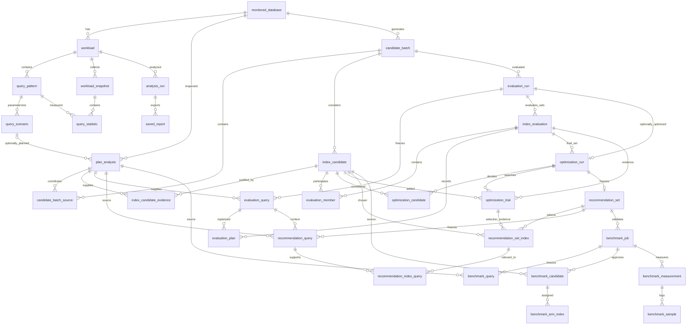

# Metadata database design

Status: migrations 0001–0008 implement targets, workloads, plans, candidates, evaluations, optimization history and recommendations. M9 migration 0009 adds durable benchmark jobs, approved input snapshots, arm membership, measurements and individual transaction samples. General reports remain planned. Demo business rows never belong in metadata.

Every entity has a primary key (UUID where externally addressed, composite keys for scoped membership) and appropriate foreign keys. Parent records supply creation times for their child evidence. Use timezone-aware timestamps, BIGINT bytes/counters/query IDs, finite nonnegative costs and positive finite frequencies. PostgreSQL query IDs can be signed; do not impose a positive queryid constraint.

| Entity | Main content and constraints |
| --- | --- |
| monitored_database | Unique configured target key; safe host/database/role identity and credential reference; no password or secret DSN. |
| workload | Database FK, source, name; each analysis uses an immutable revision of queries/frequencies. |
| query_pattern | Workload FK, source identity and normalized text; manual fingerprint separate from server queryid. Server identity includes database, role, queryid and top-level flag; queryid alone is insufficient. |
| query_scenario | Pattern FK, representative statement/bindings, frequency share; unresolved parameters explicitly prevent planning. Values are sensitive local data. |
| workload_snapshot | Workload FK, collection time, server start/reset/deallocation metadata, collection outcome and extension version. |
| query_statistic | Snapshot and pattern FKs with composite uniqueness; raw cumulative calls/time/rows/buffers. Derived deltas retain their predecessor and validity reason, or are recalculated from raw snapshots. |
| analysis_run | Workload revision, target schema/statistics provenance, configuration, status and algorithm version; settings frozen on completion. |
| candidate_batch | Target FK, generation limits/version, observation time, truncation and warnings; source plans linked through candidate_batch_source. |
| index_candidate | Batch FK, canonical signature, structured definition and proposed/rejected decision; unique signature within batch. Generation-time benefit/size remain unknown. |
| evaluation_run | Batch FK, completed/unavailable/failed status, capabilities, requested sets, context, warnings, error code and cleanup confirmation. |
| evaluation_query | Run/source-plan FKs, frozen resolved query/catalog context and positive frequency; unique source per run. |
| index_evaluation | Run FK, canonical set signature, optional weighted planner cost/bytes and warnings; unique set per run and at most one baseline. |
| evaluation_member | Composite PK of evaluation/candidate FKs; hypothetical OID/name and optional positive estimated bytes. |
| evaluation_plan | Evaluation/query FKs, raw JSON and optional nonnegative finite root cost; unique pair. Service pairs queries/sets from the same run. Empty-set evaluation supplies fresh baseline plans. |
| optimization_run | Unique evaluation-run FK, final-set FK, options and structured score/stop summary, creation time. |
| optimization_candidate | Composite run/candidate PK; selected flag, reason and unique nullable selection order; selected rows require order 1–32. |
| optimization_trial | Run/evaluated-set/added-candidate FKs, step 1–32, chosen flag, reason and score metrics; unique run/step/added candidate and at most one chosen trial per step. |
| recommendation_set | Unique optimization FK; explanation version, frozen source provenance/options, objective/stop summary, warnings and creation time. |
| recommendation_set_index | Composite recommendation/candidate PK; unique selection order/source trial, definition, positive estimated bytes, marginal explanation and quoted deployment SQL. |
| recommendation_query | Composite recommendation/source-plan PK, unique frozen evaluation-query link, frequency, original SQL, resolved context, raw baseline/final plans and explanation metrics. |
| recommendation_index_query | Composite recommendation/candidate/source-plan PK; two composite FKs enforce index/query membership in that same recommendation; frozen proposal evidence and final-use flag. |
| benchmark_job | Recommendation FK, request/confirmation, queued/running/completed/failed/cancelled status, manifest/result, cleanup/cancel flags, error and lifecycle times. |
| benchmark_query | Composite job/source-plan PK; frozen representative SQL, positive frequency and resolved source context. |
| benchmark_candidate | Composite job/candidate PK; validated frozen definition and saved IndexPilot membership flag. |
| benchmark_arm_index | Composite job/candidate/arm PK; scoped FK to approved job candidate; per_query/indexpilot arms only. |
| benchmark_measurement | Job FK; unique repetition/arm/phase, measured metrics and immutable conditions/dataset fingerprints. |
| benchmark_sample | Composite measurement/client/sequence PK; nonnegative integer microsecond latency and script ID. Failed/incomplete logs cannot become successful measurements. |
| saved_report | Analysis FK, report format/version and immutable rendered artifact or safe managed artifact reference; no arbitrary filesystem path. |

Store PostgreSQL plan trees and frozen settings as JSONB because their internal structure varies; relational keys and membership remain normalized. Do not store comma-separated query IDs or selected indexes. Ordered index keys are structured data, not an unordered set.

Separating patterns from observations prevents rewriting SQL text for every snapshot. Separating candidate indexes from evaluations handles an index participating in many trial combinations. Set membership tables implement many-to-many relationships without duplicating candidate definitions. Benchmark measurements belong to runs because conditions and configuration arms matter as much as a latency number.

Use database constraints for uniqueness, nonnegative bytes, valid job states and FK scope wherever practical; application validation also rejects NaN/Infinity. Index FKs used for history queries, collection-time ordering and `(run_id, arm, repetition)`. Use migrations and transaction rollback tests. Deletion is explicit and scoped; preserve historical analyses by default, and do not cascade-delete benchmark evidence unexpectedly.

The e-commerce demo has separate `users`, `products`, `orders`, `order_items` and `payments` tables. Orders reference users; items reference orders and products; payments reference orders. Primary/unique constraints provide required indexes, while additional performance indexes are deliberately absent for experiments. Foreign keys do not automatically create indexes on their referencing columns.

## M3 implementation details

Workloads belong to a saved configured target. Pattern identity is unique within a workload: structural fingerprint for manual input, full server database/user/query/top-level identity for collection. Scenarios retain original SQL, typed parameter JSON, resolved representative text or missing positions, and positive bounded frequency. Different parameter values can share a pattern without overwriting each other.

Each snapshot owns many statistic rows, with unique `(snapshot_id, pattern_id)` pairs. SQL text and raw cumulative values are retained at capture time. Calls, rows and execution times are typed constrained columns; ten named buffer counters use validated JSONB. Snapshot metadata supplies reset/start/eviction provenance. Deltas are calculated from saved raw snapshots rather than redundantly persisted. Foreign-key indexes support retrieval; no delete API or automatic historical deletion is provided.

Migration 0002 was upgraded, downgraded to 0001 and upgraded again on a separate disposable metadata database. The main metadata database was upgraded without a destructive downgrade. Alembic schema comparison found no drift.

## M4 implementation details

`plan_analysis` references the configured target and optionally a saved scenario; ad hoc plans need no artificial workload row. It stores original SQL, frequency, source capture time/version, resolved query/catalog context, raw EXPLAIN JSON, selected settings and extracted root summary. Cost/frequency CHECK constraints reject invalid values; target/scenario/time indexes support retrieval. JSON represents immutable variable-shaped evidence, while identities and references remain relational. M6's separate evaluation_query/evaluation_plan tables now retain later replanning evidence.

Migration 0003 upgrade → downgrade to 0002 → upgrade passed on the separate disposable metadata database, with no schema drift. Historical plan retrieval uses stored catalog context, not the target's latest mutable schema/statistics.

## M5 implementation details

`candidate_batch` stores the configured target, capture timestamps, requested limits, algorithm version, counts, truncation status and warnings. `candidate_batch_source` links each source plan once. `index_candidate` stores one structured definition/signature per batch with a constrained proposed/rejected status and reason. `index_candidate_evidence` uses a composite candidate/plan/alias/reason key, preserving many-to-many query provenance with foreign keys. Variable key signatures remain immutable structured JSON; source relationships are not hidden in delimited strings.

Migration 0005 converts the endpoint prototype's JSON evidence into normalized rows. Its downgrade reconstructs that evidence without dropping candidate/batch records; a full data-bearing round trip was checked. Analysis_run, recommendation, benchmark and report entities in the design diagram remain proposed.

## M6 implementation details

An evaluation_run belongs to one candidate_batch. It freezes representative query context/frequency once per source in evaluation_query. Each index_evaluation records the empty baseline or a complete candidate set; evaluation_member links its candidates with session-local identifiers and estimated bytes. Evaluation_plan links each set to each frozen query and retains its raw PostgreSQL EXPLAIN. A per-run partial unique index allows at most one baseline. Foreign keys, set/query uniqueness, finite cost checks and positive member-size checks protect stored records; application validation enforces same-run/same-batch membership.

Runs are saved atomically after synchronous evaluation, including safe failed/unavailable records; failures publish no partial comparisons. There is no persistent running-job state in M6. Retrieval uses frozen evidence without connecting to the target. Query literals, plans and statistics remain sensitive local metadata. Hypothetical identifiers are historical session names, never physical deployment identifiers.

Migration 0006 upgrade, downgrade to 0005 and re-upgrade passed on the separate disposable metadata database; Alembic reported no schema drift. The main metadata database was upgraded to 0006 without downgrading its saved data.

## M7 implementation details

`optimization_run` references a complete M6 evaluation history and its fresh-verified final set. `optimization_candidate` normalizes outcomes and selection order rather than hiding selected membership in a JSON array. `optimization_trial` links each considered addition to its complete evaluated set. Raw plans, hypothetical member bytes and frozen query context are reused through M6's relationships; per-query trial changes can be reconstructed against that run's baseline. Settings and variable score summaries remain structured JSON, while identities and membership stay relational.

Database constraints prevent duplicate trial additions/selection positions and multiple chosen alternatives at one step. Explicit non-null validation in the selected-position CHECK avoids PostgreSQL's rule that a NULL CHECK result passes. Service validation enforces same-batch/same-evaluation scope; foreign keys alone do not prove cross-row scope. Selected order is preserved; history lists trial rows in stable step/UUID order.

A single outer metadata transaction contains both M6 evidence and M7 history writes. A real duplicate-membership failure during the second part rolled back the entire new evaluation, leaving the prior saved run unchanged. Planning failures instead save a separate safe failed/unavailable evaluation with no optimization selection or partial trial plans. There is no long-running optimizer job state.

Migration 0007 upgrade → downgrade to 0006 → upgrade passed on the separate disposable metadata database, with no schema drift. The main database was only upgraded. M8 will extend the saved evidence into richer recommendation explanations and artifacts; M7 does not claim that work is complete.

## M8 implementation details

One recommendation_set freezes one completed optimization. It copies selected membership/order, index structure, relevant-query proposal evidence, source query context, raw plans, settings, versions, observed statistics timestamps and explanation metrics. Source FKs preserve provenance, while copied values prevent later source edits from rewriting the saved recommendation. No update/delete API is provided; privileged metadata administrators can still alter database rows directly. Raw evidence/explanation metrics are frozen; compatible plan parsing/display uses the reader version.

Recommendation_set_index separates reusable candidate identity from this recommendation's selection-step evidence. Recommendation_query separates final whole-set query contributions from index attribution. Recommendation_index_query stores many-to-many relevance with composite scope FKs, preventing a query from a different recommendation being attached accidentally. Positive size/order/frequency checks and unique source/order constraints protect saved records. Service checks enforce source optimization/batch/trial consistency beyond those FKs.

Header and child rows commit in one metadata transaction. Creation locks only the source optimization to serialize duplicate snapshots, returning the existing record on repeats. Reads use the frozen rows and do not reconnect to the target or source optimizer content. Tests demonstrated source-mutation independence, atomic rollback after partial staging and valid use with one pool connection. Migration 0008 upgrade → downgrade to 0007 → upgrade passed on the separate disposable metadata database; retained main data was only upgraded. Benchmarks/reports remain future entities in the diagram.

## M9 implementation details

Benchmark jobs are separate measured outcomes linked to a recommendation; the historical recommendation's capture-time null benchmark outcome is not overwritten. An enqueue transaction freezes approved queries/candidates and explicit confirmation. Bounded queue/worker/target locks control claiming. The worker persists terminal failures/cancellation/recovery with cleanup confirmation rather than inventing completed results. Startup recovery does not resume partial experiments; it cleans owned resources safely and marks interruption failed before claiming another job.

Every successful measurement owns individual samples, while its job/arm/repetition/phase conditions preserve experimental context. Uniqueness/check constraints reject duplicate transactions, negative samples and invalid arms/states. Composite arm membership FKs prevent using a candidate approved for a different job. Services enforce recommendation/source scope beyond those FKs. Durably completed phases may remain after an overall failed job, but no successful whole-job result is published. Raw stdout/logs remain in ignored local artifacts; a small sanitized summary is checked in separately.

Migration 0009 upgrade → downgrade to 0008 → upgrade passed only on the separate disposable metadata database, with no drift. Main recommendations/history were retained and upgraded. Cleanup touches generated benchmark schemas, not metadata parent records or existing public indexes. General reports remain planned.

## M11 report storage

Migration 0010 adds saved_report: UUID primary key, recommendation foreign key, indexed created_at/recommendation_id, bounded title, constrained format_version and JSONB document. A report is an explicit immutable-through-API snapshot; the indexed header supports filtering while the document preserves the versioned export independently of later source joins. Benchmark/query/candidate identities inside it are historical references, not a replacement for normalized source tables. A single repeatable-read metadata transaction assembles and saves the report. The source recommendation FK preserves ownership; there is no report edit/delete API. Exports never require a monitored-target connection.
