# Schema and estimated plan analysis

Implemented in M4. The engine resolves supported SQL against actual PostgreSQL catalogs, obtains EXPLAIN JSON without ANALYZE, recursively parses the result and saves the evidence. It does not recommend or create indexes, execute submitted workloads, or measure query latency.

## Run a real example

From the repository root, with the database running:

```powershell
uv sync --locked
uv run alembic upgrade head
uv run uvicorn indexpilot.main:app --host 127.0.0.1 --port 8000
```

Open `/docs`, or submit this request:

```powershell
$body = @{
  sql = 'SELECT o.id, o.total FROM public.orders o WHERE o.user_id=$1 ORDER BY o.created_at DESC'
  frequency = 100
  parameters = @{ '1' = @{ type = 'int8'; value = 101 } }
} | ConvertTo-Json -Depth 6
$result = Invoke-RestMethod -Method Post `
  -Uri http://127.0.0.1:8000/api/v1/plans `
  -ContentType application/json -Body $body
$result.plan.root
$result.plan.observations
```

The same API was exercised against actual PostgreSQL in integration tests. Exact node choices and estimates can change with statistics, data, indexes and planner settings; no screenshot or hardcoded example is proof of a particular plan on another machine.

## Endpoints

| Method/path | Behavior |
| --- | --- |
| GET `/api/v1/schema` | Paginated inventory of configured schemas, table identities, row/page estimates, sizes and access flags. Optional `schema_name`, `limit`, `offset`. |
| GET `/api/v1/schema/table` | Details for `table_name` and optional `schema_name`: columns/types, sampled statistics, keys, index definitions/sizes/usage and warnings. |
| POST `/api/v1/plans` | Resolve, estimate and save one QueryInput with SQL, frequency and optional typed parameters. |
| POST `/api/v1/query-scenarios/{id}/plan` | Analyze a saved scenario using its actual SQL, parameters and frequency. Missing parameters are an error. |
| GET `/api/v1/plans/{id}` | Reload the saved raw plan, resolved features, catalog context, settings and explanation. |
| GET `/api/v1/plans` | Paginated analysis summaries, newest first. |

Schema inventory includes inspectable views and unsupported relations, with kind/access metadata; inclusion does not authorize planning. Statement/connection/lock timeouts and the existing 1 MiB request limit apply. Plan requests support at most 16 table references. Recursive plan parsing is bounded to depth 64 and 5,000 nodes. Errors distinguish missing/ambiguous references, unsupported objects, privilege failures and invalid parameter/type semantics without echoing raw driver SQL.

## Resolution and safety boundary

```mermaid
flowchart LR
    Input[SQL and representative values] --> AST[AST admission and binding]
    AST --> Catalogs[Resolve relations and columns]
    Catalogs --> Policy[Validate planning dependencies]
    Policy --> Qualified[Qualified internal SQL]
    Qualified --> Explain[EXPLAIN JSON without ANALYZE]
    Explain --> Parse[Recursive plan and explanations]
    Parse --> Save[Metadata plan record]
```



Unqualified relations mean `public`; configured additional schemas require explicit qualification. Aliases, quoted identifiers and schema-qualified columns resolve to relation OIDs and physical columns. Ambiguous names are rejected, not assigned to an arbitrary table. The resolver handles direct filtering/join predicates, ORDER BY direction/null placement, output aliases and explicit sort/group positions. Computed predicates are identified conservatively; OR/NOT predicates are not reported as unconditional conjunctions. Broader SQL constructs remain unsupported rather than guessed.

`INDEXPILOT_ANALYSIS_SCHEMAS` is an administrator-controlled JSON list, default `["public"]`. For example, `["public","analytics"]` permits explicit analytics-schema relations throughout ingestion, collection and planning. System/temp schemas are rejected. Schema names are not ignored in manual fingerprints: pglast's structural fingerprint is combined with explicit relation scope so different schemas cannot accidentally share one pattern. Existing M3 public-only records remain usable.

Planning requires permanent ordinary heap tables, table-level SELECT and schema USAGE. It rejects views/materialized views, foreign or partitioned relations, inherited tables, RLS, rules, generated columns, domains/custom types, non-B-Tree existing indexes and unsupported operator classes/collations. Existing constraint/index dependencies on unapproved functions/operators and custom casts between supported built-in types are rejected. This initial policy is intentionally conservative; an unsupported relation can still be catalog-inspected.

The engine holds ACCESS SHARE locks, qualifies relation/column names, forces ONLY for supported non-inherited relations and explicitly qualifies operators, casts and allowed aggregates with pg_catalog. EXPLAIN runs in a read-only transaction with a trusted search_path and no ANALYZE option. There is no route for arbitrary EXPLAIN options or planner switches.

These checks are **not a sandbox for hostile database administrators, extensions, planner hooks or concurrent malicious catalog changes**. Only the configured administrator-controlled local demo is supported. A privileged server can run code during planning; read-only transactions alone cannot prevent external side effects. Even approved constant expressions may be evaluated by the planner: `SELECT 1/0` returns a safe invalid-query error during planning. Ordinary query execution timing is never inferred from this behavior.

## Understanding catalog statistics

Table row/page counts and column distributions are estimates, not live row counts. Missing statistics remain null. A positive n_distinct estimates distinct values; a negative value scales with estimated table rows. The displayed uniform equality selectivity is `(1-null_fraction)/estimated_distinct_values`, a coarse average that ignores value skew and cross-column correlation. It does not replace PostgreSQL's estimator.

Column most-common values/histogram text are omitted by default. `include_values=true` explicitly includes them only for supported built-in types with appropriate access; custom output functions are not invoked to format unsupported type samples. Index metadata separates key columns from INCLUDE payload, and retains order/null flags, opclasses, collations, partial predicates, expressions, validity and constraint status. Cumulative low usage alone is not a reason to drop an index.

## Reading the plan

Every node retains its type, relation/schema/alias/index identity, estimated startup/total cost, rows, width, filter/index/recheck conditions, join conditions, sort/group keys, relationship/subplan details and child nodes. Unknown node types are retained; raw JSON preserves fields outside the structured model. The root total cost includes descendant work, so summing every node total would double-count.

Explanations cover sequential/index/index-only/bitmap scans, nested loops, hash/merge joins and sorts. A sequential scan can be reasonable for a small table or when many rows are needed. Observed page counts/output fractions are possible factors, not proof of the optimizer's exact reasoning. Parallel-worker row estimates are not presented as whole-table selectivity.

All results carry `cost_unit: planner_cost` and `execution_measured: false`. Estimated plans containing execution metrics are rejected by the parser. Planner costs are not milliseconds; physical before/after experiments remain M9 work.

## Persistence and verification

Migration 0003 creates `plan_analysis`: target FK, optional saved-scenario FK, frequency, source timestamp, original SQL, resolved query/catalog JSON, raw EXPLAIN JSON, selected planner settings and root summary. Reloading uses saved context rather than current catalogs. Explanations are deterministically regenerated from that saved evidence; wording may evolve with software versions. SQL/parameters/conditions remain sensitive local metadata.

M4 verification executed 166 tests, including 29 new real PostgreSQL/API integration cases. Tests create isolated uniquely named fixture schemas/tables/indexes in the dedicated local demo cluster and remove them afterward; application endpoints never create physical indexes. Some tests set session-local planner switches to obtain real bitmap/index-only/hash/merge/nested-loop nodes. Those forced plans exercise parsing, not index-effectiveness or benchmark claims. Migration reversal is tested only on the separate disposable metadata database.

Sources: PostgreSQL documents [EXPLAIN estimates and execution behavior](https://www.postgresql.org/docs/18/sql-explain.html), [index catalog semantics](https://www.postgresql.org/docs/18/catalog-pg-index.html) and [sampled column statistics](https://www.postgresql.org/docs/18/view-pg-stats.html).
